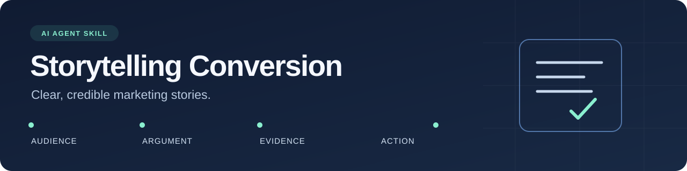

<div align="center">



# Storytelling Conversion

**An AI agent skill for clear, credible marketing stories.**

Decide whether to answer, edit, create, investigate, or plan. Apply narrative techniques where they help, with claims grounded in evidence.

[](https://github.com/takimdigital/storytelling-conversion/actions/workflows/validate.yml)
[](https://github.com/takimdigital/storytelling-conversion/releases/latest)
[](LICENSE)

[Install](#install) · [Try it](#try-it) · [Examples](examples/README.md) · [Contribute](CONTRIBUTING.md)

</div>

## What it does

Storytelling Conversion gives an AI assistant a workflow for business communication: identify the work needed, find a useful point, develop it through a fitting approach, and check it against the brief. It can recommend changing an existing message instead of creating another asset.

Use it to:

- Improve an opening that feels vague or loses attention.
- Explain a product through a recognizable situation and a clear mechanism.
- Write emails, landing-page sections, social posts, sales scripts, and case studies.
- Diagnose a story that sounds polished but never makes its point.
- Adapt a narrative for another format or language.
- Make a precise edit while preserving the rest of the copy.
- Discover whether an existing answer is buried, unclear, or missing.
- Choose a small communication experiment within a realistic time budget.

The skill keeps customer stories, illustrations, and measured results distinct. It gives unsupported claims a useful alternative and an evidence requirement. Short utility copy stays short.

## Before and after

**Brief:** A fictional reporting tool combines uploaded CSV files into one table. No customer outcomes have been measured.

| Before | After |
|---|---|
| “Transform your productivity with revolutionary reporting. Save 80% of your time, guaranteed.” | “Combine uploaded CSV files into one table. Try the CSV combiner.” |

The revision explains the actual capability and removes the invented result. Longer narratives get the same attention to relevance and proof.

## Install

### Codex: ask the skill installer

Paste this into Codex:

```text
$skill-installer install https://github.com/takimdigital/storytelling-conversion/tree/main/skills/storytelling-conversion
```

For a version-pinned installation, replace `main` with `v1.1.0`. If an existing installation conflicts, review it before replacing it. If the skill does not appear, restart Codex. See the [official skill documentation](https://learn.chatgpt.com/docs/build-skills).

### Manual installation

Download a [release](https://github.com/takimdigital/storytelling-conversion/releases/latest) or clone this repository, then copy the **entire** `skills/storytelling-conversion` folder into your agent's skills directory. Include its `references` and `agents` folders.

For Codex, use `.agents/skills/` in your project, or `~/.agents/skills/` for your user account. The resulting path should end with `storytelling-conversion/SKILL.md`.

The `.skill` release asset is a ZIP archive containing that folder. Extract it with a ZIP-compatible tool; it is not an executable installer. Each release includes a SHA-256 checksum.

### Other assistants

The core instructions use the [Agent Skills format](https://agentskills.io/specification). Assistants that support this format may use the skill, but their discovery paths and invocation syntax vary. Codex is the documented installation target; other integrations have not been independently verified. You can also supply the Markdown instructions and relevant references directly to your assistant.

## Try it

```text
Use $storytelling-conversion to rewrite this landing-page section.

Audience: freelance designers.
Verified product facts: clients can choose an available appointment time
and receive an email confirmation.
Goal: invite the reader to try booking.
Voice: practical and friendly.
Limit: 80 words. Do not invent customer outcomes.

Draft: [paste your copy]
```

For a targeted edit:

```text
Use $storytelling-conversion to improve only the first sentence.
Keep the offer, facts, and remaining copy unchanged.
[paste your copy]
```

For an audit:

```text
Use $storytelling-conversion to find the three most important problems
in this sales story. Explain each problem and give a concrete repair.
Separate unsupported claims from writing issues.
[paste your story and supporting facts]
```

More prompts and illustrative outputs: [examples](examples/README.md).

## How it works

1. **Choose the work.** Answer directly, edit, create, investigate, or propose an experiment.
2. **Find the useful point.** Choose a specific uncertainty, distinction, demonstration, or decision.
3. **Develop the idea.** Draft the payoff before polishing the hook; connect the product where it belongs.
4. **Keep it grounded.** Preserve factual support, material terms, and the scope of the offer.
5. **Review the result.** Check whether it resolves the actual question and earns the reader's attention.
6. **Deliver proportionately.** Give the requested work, with material limitations kept separate.

The skill includes techniques for openings, context, concrete imagery, structure, purposeful details, specific obstacles, engaging explanations, and meaningful endings. It selects what the assignment needs.

## What's included

```text
skills/storytelling-conversion/
├── SKILL.md                 Core workflow and trigger description
├── LICENSE                  License travels with the installed skill
├── agents/openai.yaml       Codex display metadata
└── references/
    ├── principles.md        Narrative choices and practical tests
    ├── direction.md         Discovery and small marketing decisions
    ├── production.md        Briefs, evidence, formats, and experiments
    └── review.md            Review rubric, examples, and repairs
```

The installed skill is instruction-only. It requires no API key, account connection, executable helper, or external service. This repository's Python scripts are maintenance tools, not part of the installed skill.

## Quality and limitations

Automated checks validate structure, local links, scenario fixtures, and reproducible builds on Windows and Linux. Writing scenarios support qualitative review; they do not measure audience response or conversion gains. Exploratory with/without checks informed the workflow revisions, but did not establish consistent superiority over an assistant without the skill. See [evaluation guidance](evals/README.md). The skill cannot verify missing customer evidence or guarantee results.

Drafting copy does not authorize publication, scheduling, account access, spending, or deployment. Follow the permissions and project rules in your own environment.

## Maintain and contribute

```bash
python scripts/validate.py
python -m unittest discover -s tests -v
python scripts/build.py
```

Python 3.11+ is required for repository tooling. There are no third-party Python dependencies.

Read [CONTRIBUTING.md](CONTRIBUTING.md) for the edit, review, and release process. Report a reproducible problem through [GitHub Issues](https://github.com/takimdigital/storytelling-conversion/issues/new/choose). Include a sanitized prompt, the result, and the behavior you expected.

**License:** [MIT](LICENSE). You may use, adapt, and redistribute the skill under its terms.
